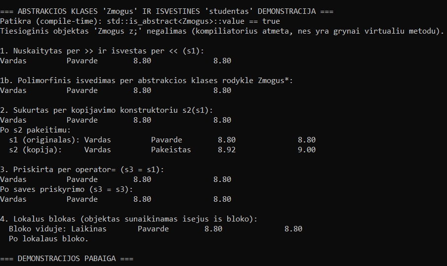
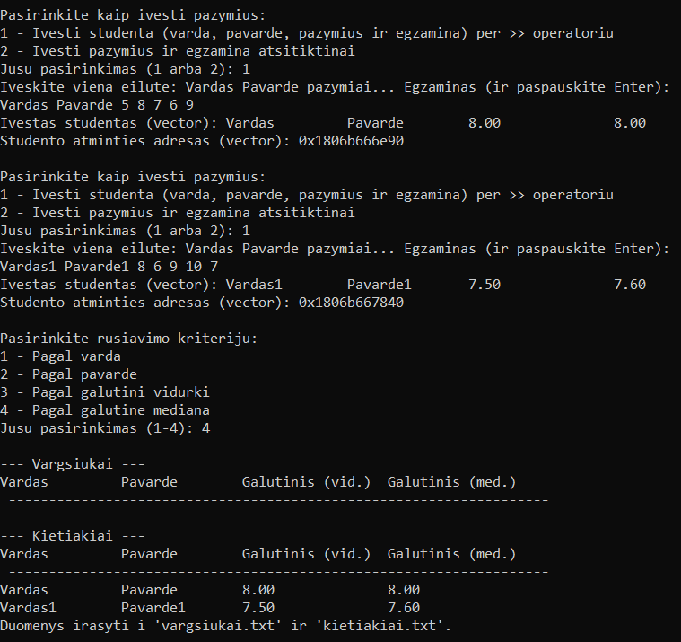
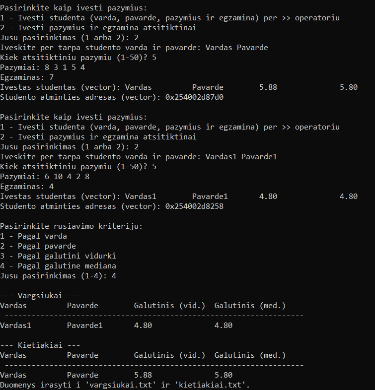
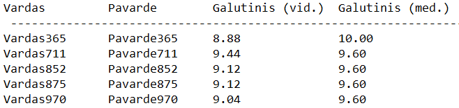

# Studentų apdorojimo programa (v1.5)

Programoje realizuota abstrakti bazinė klasė `Zmogus` ir iš jos išvestinė klasė `studentas` su **Rule of Three** (`studentas(const studentas&)`, `operator=`, `~studentas()`), perdengtais įvesties ir išvesties operatoriais (`operator>>`, `operator<<`), darbu su `std::vector` bei `std::list` konteineriais, skaidymo strategijomis, failais, rankiniu bei automatiniu pažymių generavimu.

## Klasės `Zmogus` ir išvestinės klasės `studentas` architektūra

* **`Zmogus` (abstrakti bazinė klasė):** turi grynai virtualius metodus (`= 0`, įskaitant `spausdintiInfo(std::ostream& os) const`) ir `static_assert(std::is_abstract<Zmogus>::value, ...)`, todėl tiesiogiai sukurti `Zmogus` tipo objektų negalima; kopijavimo konstruktorius ir `operator=` pažymėti `= delete`.
* **`studentas` (išvestinė klasė iš `Zmogus`):** paveldi `public Zmogus`, perrašo virtualius metodus (`override`), palaiko *Rule of Three* (kopijavimo konstruktorius, priskyrimo operatorius su apsauga nuo `this == &other`, destruktorius) ir automatiškai perskaičiuoja galutinius balus (`galutinis_vid_` ir `galutinis_med_`) keičiant pažymius ar egzaminą.
* **Išsaugota `v1.2` veikimo logika:** išliko visi trys darbo režimai, spartos analizė su `std::vector` ir `std::list`, 1–3 skaidymo strategijos, rankinis/atsitiktinis/failinis įvedimas bei išvedimas į ekraną ir failus.

## Perdengti įvesties ir išvesties operatoriai

### Įvesties operatorius (`operator>>`)
* Skaito duomenis iš srauto (`std::istream` – pvz., eilutės per `std::istringstream` iš failo arba konsolės): vardą, pavardę, namų darbų pažymius (`1..10`) ir paskutinį skaičių kaip egzaminą, tikrindamas srauto būseną bei pažymių ribas.
* Automatiškai perskaičiuoja galutinius balus (`galutinis_vid_` ir `galutinis_med_`).
* **Rankinis būdas:** vartotojas įveda eilutę konsolėje (`Vardas Pavarde pazymiai... Egzaminas`), kuri nuskaitoma per `operator>>` į `std::istringstream`.
* **Automatinis / atsitiktinis būdas:** atsitiktinai sugeneruojami pažymiai ir egzaminas (`atspazymiai(1, 10)`), o priskyrus juos per `pridetiNd` / `setEgz` atnaujinami galutiniai balai; pats `operator>>` atsitiktinių skaičių negeneruoja.
* **Iš failo:** failo eilutės nuskaitomos į `std::stringstream` ir perduodamos `operator>>`.

### Išvesties operatorius (`operator<<`)
* Suformatuoja studento duomenis (vardas, pavardė, galutinis pagal vidurkį, galutinis pagal medianą – 2 skaičiai po kablelio) ir išsaugo/atstato srauto vėliavėles bei tikslumą.
* **Į ekraną:** naudojamas spausdinant studentus į konsolę (`std::cout`), taip pat per `spausdintiInfo` (polimorfiškai per `Zmogus*`).
* **Į failą:** naudojamas įrašant suformuotus rezultatus į failus (`vargsiukai.txt`, `kietiakiai.txt` per `printas`).

### Funkcionalumo ir spartos santrauka

| Režimas / Funkcija | Konteineriai / Klasės | Aprašymas |
| :--- | :--- | :--- |
| Spartos analizė | `std::vector`, `std::list` | Failų tikrinimas/generavimas, skaitymas, rūšiavimas, 1–3 dalijimo strategijos ir įrašymas į failus |
| Įprastas vykdymas | `std::vector`, `std::list` | Duomenų įvedimas iš failo, ranka arba su automatiniu pažymių generavimu; išvedimas į ekraną ir failus |
| Klasės demonstracija | `Zmogus`, `studentas` | `std::is_abstract<Zmogus>`, `Zmogus*` polimorfizmas, `>>` ir `<<`, kopijavimo konstruktorius, `operator=`, `s3 = s3`, lokalaus bloko sunaikinimas |

## Ekrano nuotraukos

### 1. Klasės `Zmogus` ir `studentas` demonstracija (`>>`, `<<`, Rule of Three)

### 2. Rankinis įvedimas ir automatinis pažymių generavimas

### 3. Išvestis į failą (`vargsiukai.txt` / `kietiakiai.txt`)

