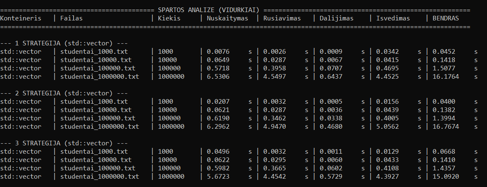
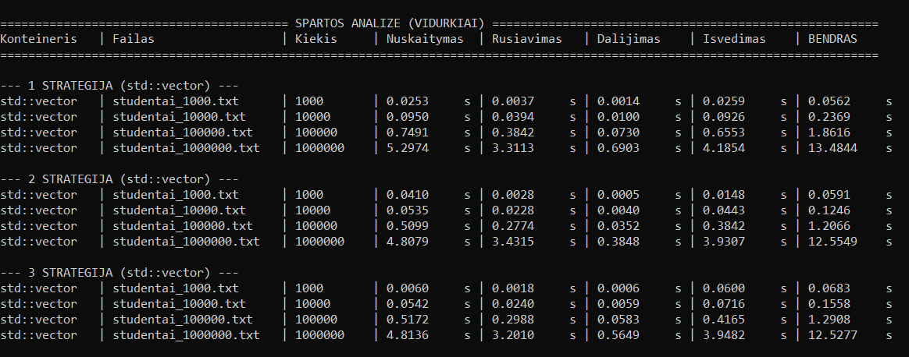
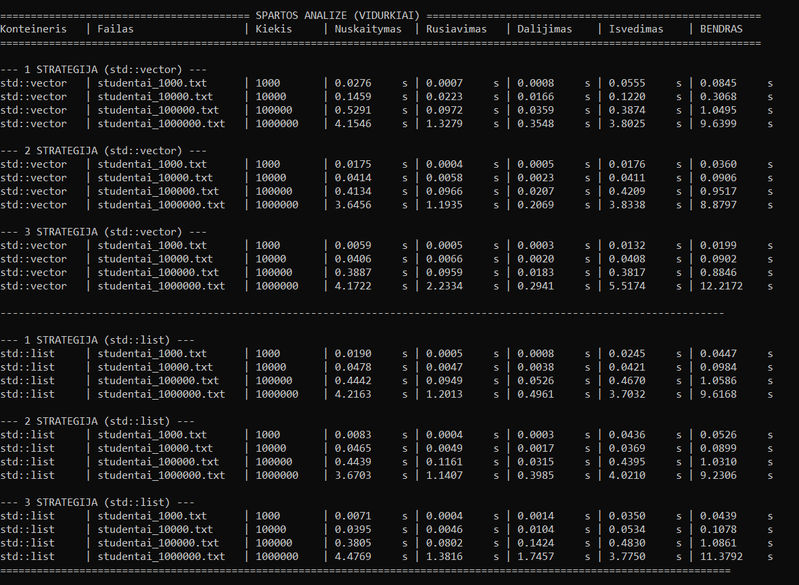
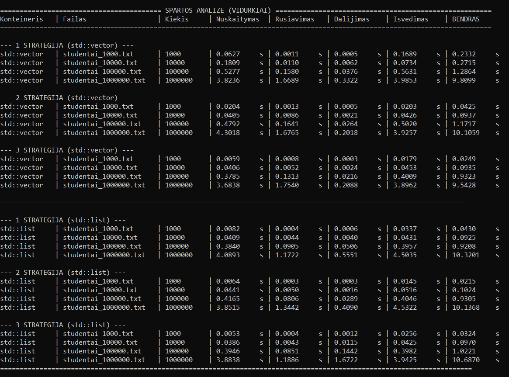
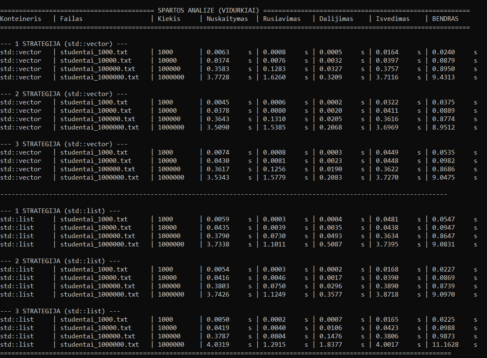

# Spartos analizė: `struct` vs `class`

Šioje analizėje lyginama C++ programos sparta naudojant `struct` ir `class` tipo Studentus (naudojant `std::vector` ir greičiausią 3-iąją dalijimo strategiją).

## Rezultatų palyginimas

### 100 000 studentų (`studentai_100000.txt`)
| Etapas | `struct` (s) | `class` (s) | Skirtumas (s) |
| :--- | :---: | :---: | :---: |
| **Nuskaitymas** | 0.5172 | 0.5982 | +0.0810 |
| **Rūšiavimas** | 0.2988 | 0.3665 | +0.0677 |
| **Dalijimas** | 0.0583| 0.0602 | +0.0019 |
| **Išvedimas** | 0.4165 | 0.4108 | -0.0057 |
| **BENDRAS LAIKAS** | **1.2908** | **1.4357** | **+0.1449** |

---

### 1 000 000 studentų (`studentai_1000000.txt`)
| Etapas | `struct` (s) | `class` (s) | Skirtumas (s) |
| :--- | :---: | :---: | :---: |
| **Nuskaitymas** | 4.8136 | 5.6723 | +0.8587 |
| **Rūšiavimas** | 3.2010 | 4.4542 | +1.2532 |
| **Dalijimas** | 0.5649 | 0.5729| +0.0080 |
| **Išvedimas** | 3.9482 | 4.3927] | +0.4445 |
| **BENDRAS LAIKAS** | **12.5277** | **15.0920** | **+2.5643** |

---

### Spartos analizė (`class` vs `struct`)

## Išvados
* **`struct` veikia greičiau:** Apdorojant 100 000 įrašų sutaupoma ~0.14 s, o su 1 000 000 įrašų – ~2.56 s.
* **Priežastis:** `struct` struktūra yra paprastesnė, joje duomenys pasiekiami tiesiogiai (be papildomų metodų ar inkapsuliacijos apvalkalų), todėl kompiliatoriui lengviau optimizuoti nuskaitymo bei rūšiavimo operacijas.

# Spartos analizė pagal kompiliatoriaus optimizavimo lygius (`-O1`, `-O2`, `-O3`)

Šioje analizėje tiriamas C++ programos (naudojančios `class` tipo Studentus) veikimo laikas, priklausomai nuo kompiliatoriaus optimizavimo lygio (`-O1`, `-O2`, `-O3`). Tyrimas atliktas su dviem didžiausiais failais (`100 000` ir `1 000 000` įrašų) naudojant `std::vector` bei `std::list` konteinerius (pateikiami greičiausios, 3-iosios strategijos rezultatai).

---

## 1. `std::vector` rezultatai (3 strategija)

| Failo dydis | `-O1` bendras laikas | `-O2` bendras laikas | `-O3` bendras laikas |
| :--- | :---: | :---: | :---: |
| **100 000 įrašų** (`studentai_100000.txt`) | 0.8846 s | 0.9323 s | 0.8686 s |
| **1 000 000 įrašų** (`studentai_1000000.txt`) | 12.2172 s | 9.5428 s | 9.0475 s |

---

## 2. `std::list` rezultatai (3 strategija)

| Failo dydis | `-O1` bendras laikas | `-O2` bendras laikas | `-O3` bendras laikas |
| :--- | :---: | :---: | :---: |
| **100 000 įrašų** (`studentai_100000.txt`) | 1.0861 s | 1.0221 s | 0.9873 s |
| **1 000 000 įrašų** (`studentai_1000000.txt`) | 11.3792 s | 10.6870 s | 11.1628 s |

---
### Spartos analizė (-O1)

### Spartos analizė (-O2)

### Spartos analizė (-O3)

## Išvados
* **Optimizavimo įtaka:** Įjungus aukštesnius optimizavimo lygius (`-O2` ir `-O3`), žymiai pagreitėja didelių duomenų kiekio (1 000 000 įrašų) apdorojimas naudojant `std::vector` konteinerį (laikas sumažėja nuo ~12.2 s iki ~9.0 s).
* **Konteinerių palyginimas optimizavus:** Prie `-O3` optimizavimo `std::vector` tampa pastebimai pranašesnis už `std::list` apdorojant milijoną įrašų (~9.0 s prieš ~11.2 s).