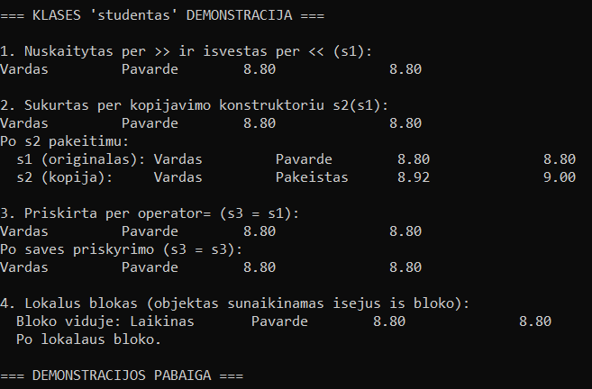
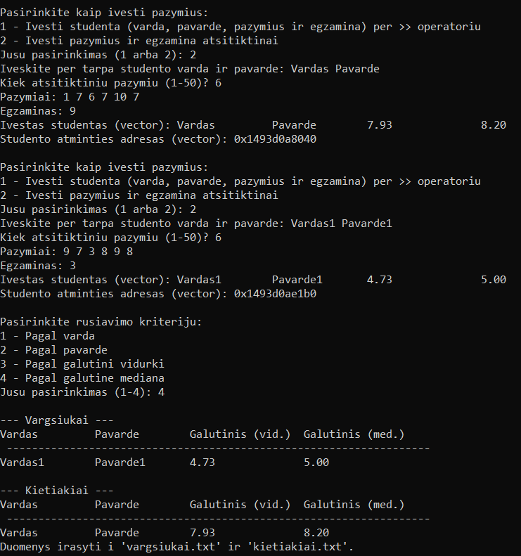
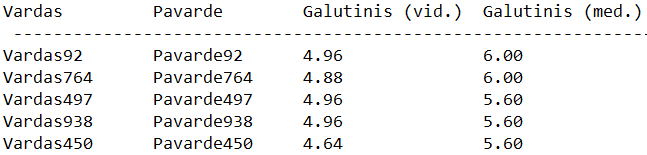

# Studentų apdorojimo programa (v1.2)

Programoje realizuota `studentas` klasė su **Rule of Three** (`studentas(const studentas&)`, `operator=`, `~studentas()`) bei perdengtais įvesties ir išvesties operatoriais (`operator>>`, `operator<<`), taip pat darbas su `std::vector` ir `std::list` konteineriais, failais, rankiniu bei automatiniu duomenų generavimu.

## Perdengti įvesties ir išvesties operatoriai

### Įvesties operatorius (`operator>>`)
* Skaito duomenis iš srauto (`std::istream` – pvz., failo per `std::ifstream`, eilutės per `std::istringstream` arba konsolės): vardą, pavardę, namų darbų pažymius (`1..10`) ir paskutinį skaičių kaip egzaminą.
* Automatiškai perskaičiuoja galutinius balus (`galutinis_vid_` ir `galutinis_med_`).
* **Rankinis būdas:** vartotojas įveda duomenis konsolėje (eilute per `>>` arba atskirai vardą ir pavardę).
* **Automatinis / atsitiktinis būdas:** atsitiktinai sugeneruojami pažymiai ir egzaminas (`atspazymiai(1, 10)`), o priskyrus juos per `pridetiNd` / `setEgz` atnaujinami galutiniai balai; pats `operator>>` atsitiktinių skaičių negeneruoja.
* **Iš failo:** eilutės iš tekstinių failų nuskaitomos į `std::istringstream` ir perduodamos `operator>>`.

### Išvesties operatorius (`operator<<`)
* Suformatuoja studento duomenis (vardas, pavardė, galutinis pagal vidurkį, galutinis pagal medianą – 2 skaičiai po kablelio) ir išsaugo/atstato srauto vėliavėles bei tikslumą.
* **Į ekraną:** naudojamas spausdinant studentus į konsolę (`std::cout`).
* **Į failą:** naudojamas įrašant suformuotus rezultatus į failus (pvz., `vargsiukai.txt`, `kietiakiai.txt`).

## Funkcionalumo ir spartos santrauka

| Režimas / Funkcija | Konteineriai | Aprašymas |
| :--- | :--- | :--- |
| Spartos analizė | `std::vector`, `std::list` | Failų generavimas, skaitymas, rūšiavimas ir skaidymas į grupes |
| Įprastas vykdymas | `std::vector`, `std::list` | Duomenų įvedimas iš failo, ranka arba su automatiniu pažymių generavimu; išvedimas į ekraną ir failus |
| Klasės demonstracija | `studentas` | `>>` ir `<<`, kopijavimo konstruktorius, `operator=`, `s3 = s3`, lokalaus bloko sunaikinimas |

## Ekrano nuotraukos

### 1. Klasės `studentas` demonstracija (`>>`, `<<`, Rule of Three)

### 2. Rankinis įvedimas ir automatinis pažymių generavimas

### 3. Išvestis į failą (`vargsiukai.txt` / `kietiakiai.txt`)

